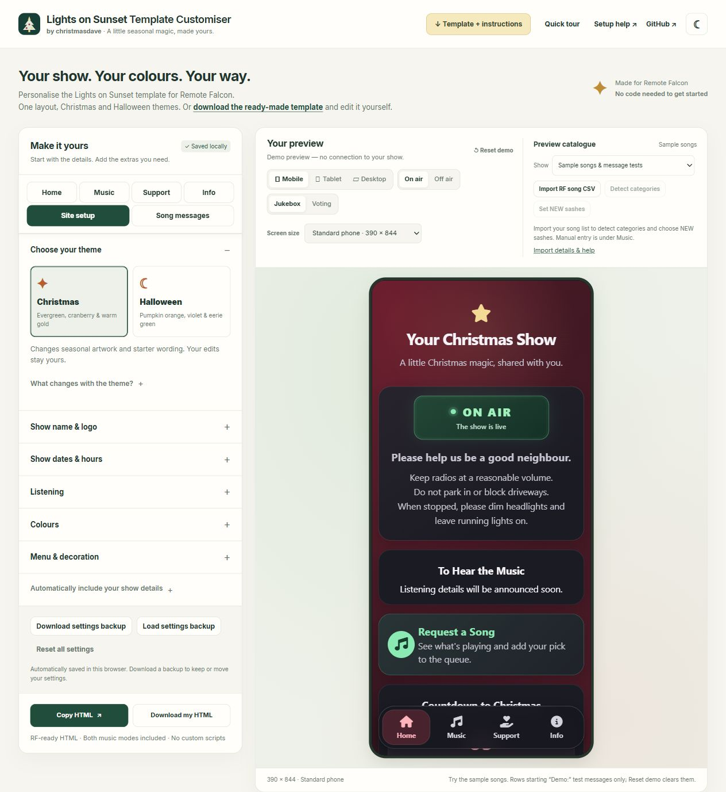
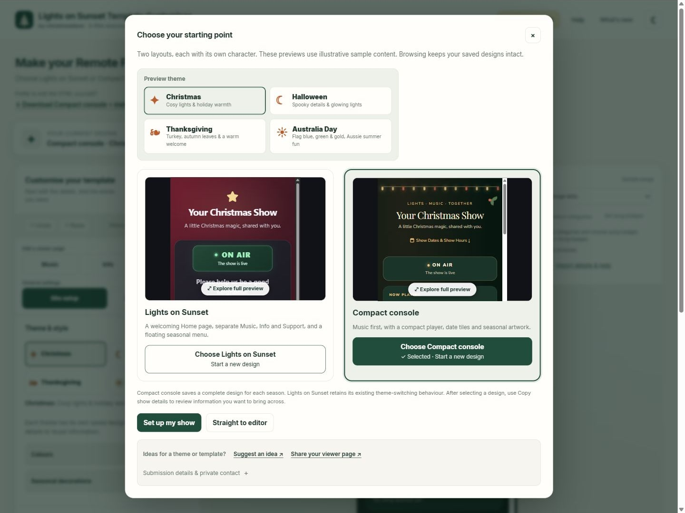
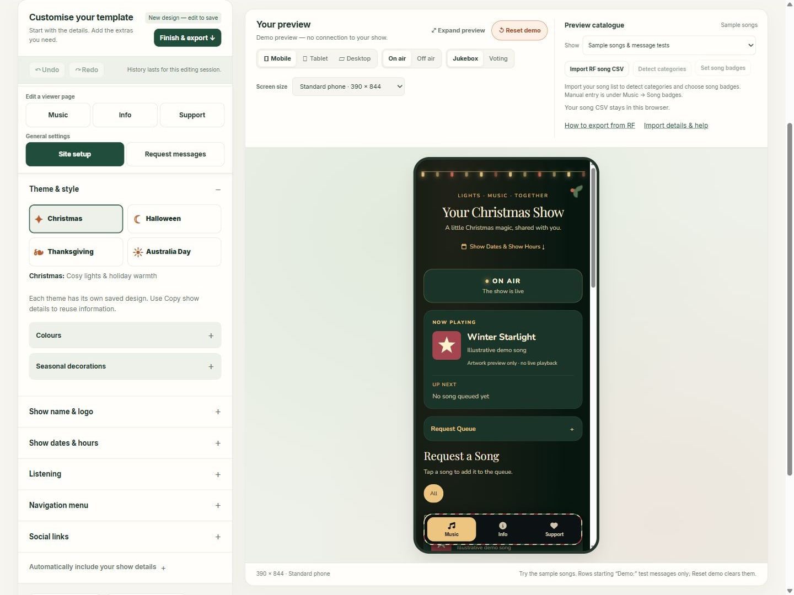
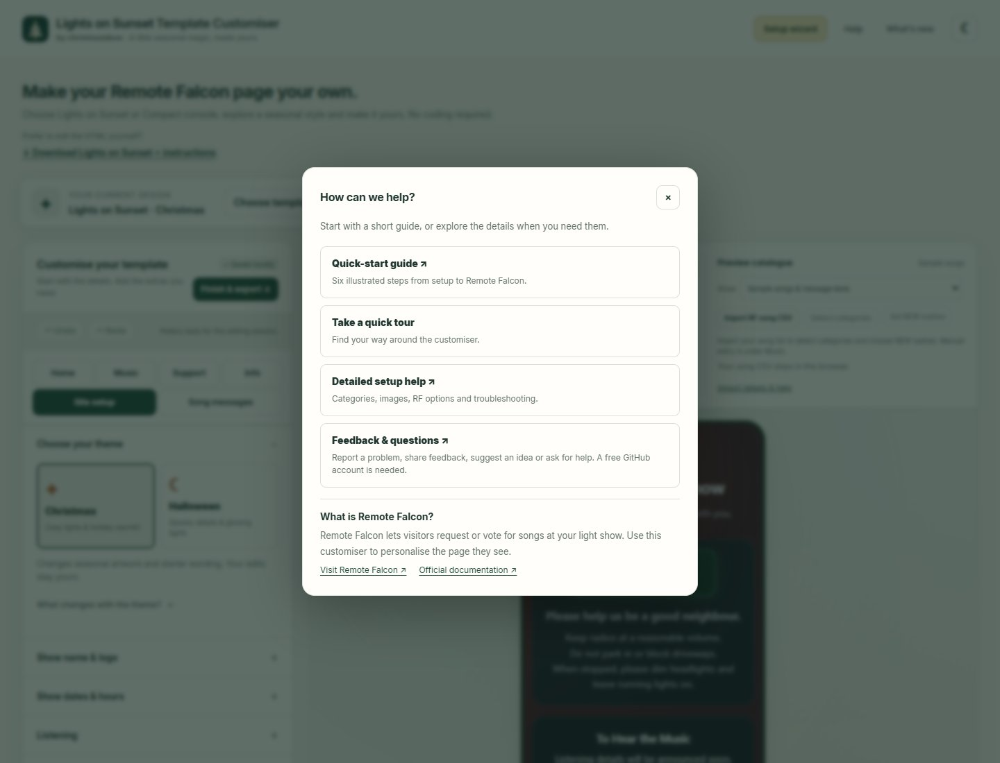
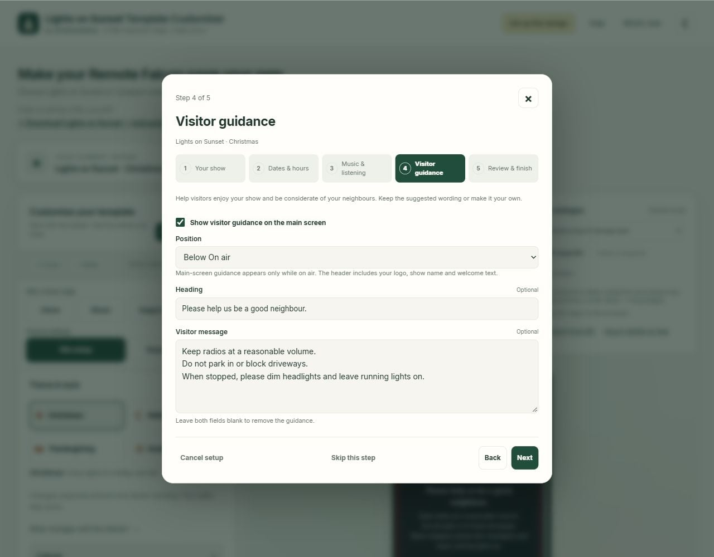
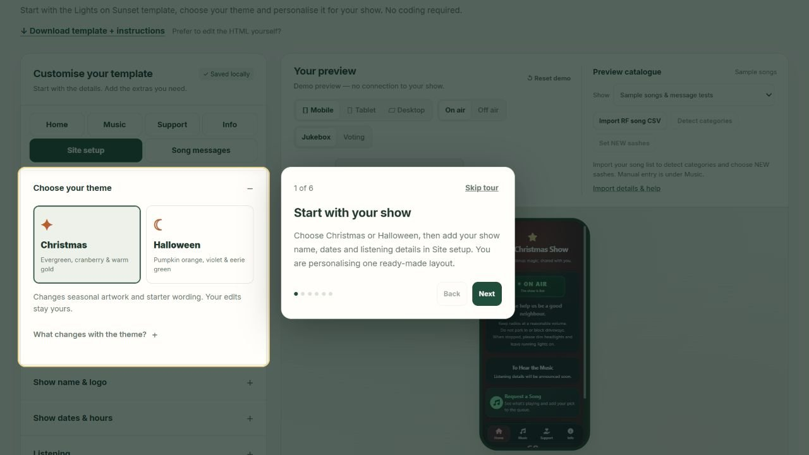
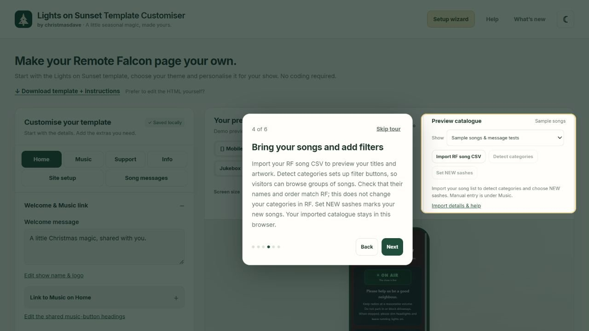
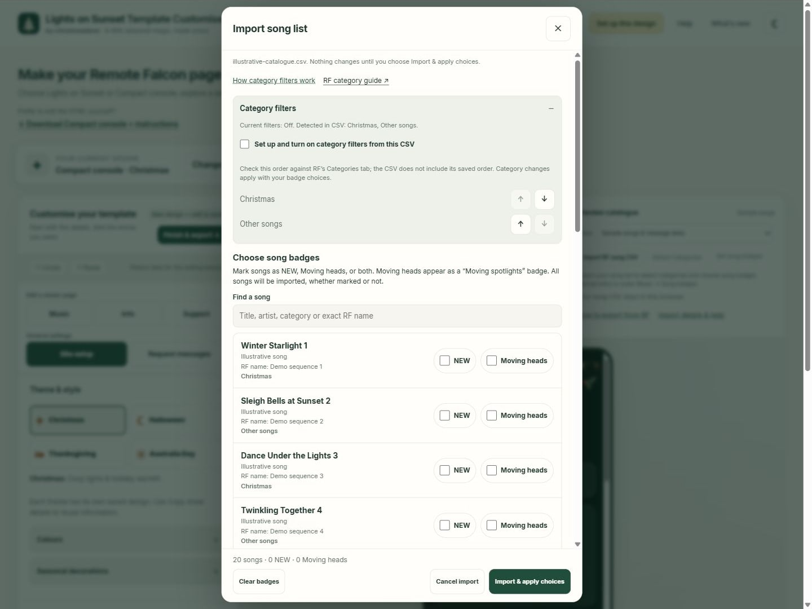
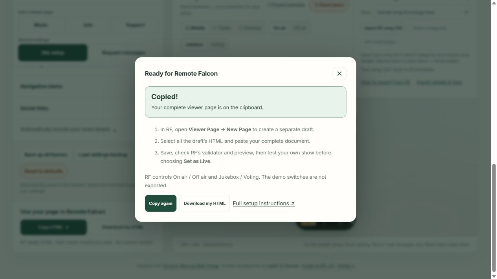
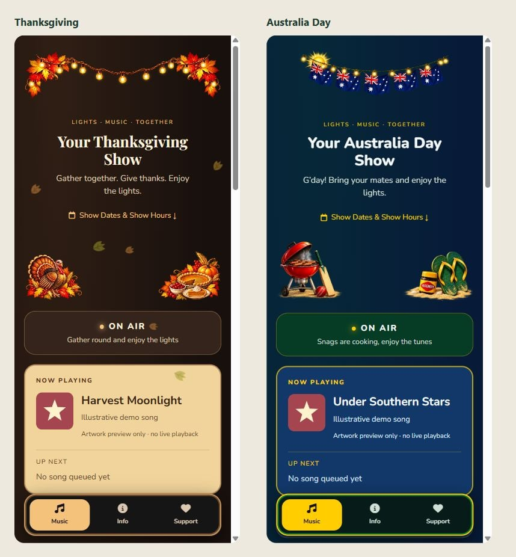

# Lights on Sunset Template Customiser

**Make your Remote Falcon page your own.**

Choose Lights on Sunset or Compact console, explore a seasonal style and personalise it for your show. No coding required. Each ready-made download includes all four seasonal starters and instructions.

**By christmasdave · Lights on Sunset.** The customiser personalises supplied layouts; each template retains its own visual identity.

[Open the template customiser](https://lightsonsunset.github.io/remote-falcon-template/) · [Download Lights on Sunset](https://lightsonsunset.github.io/remote-falcon-template/downloads/Festive-RF-Template.zip) · [Download Compact console](https://lightsonsunset.github.io/remote-falcon-template/downloads/Compact-Console.zip) · [Full setup guide](https://lightsonsunset.github.io/remote-falcon-template/START-HERE.html)

**New to Remote Falcon?** [Remote Falcon](https://remotefalcon.com/) lets visitors request or vote for songs at your light show. Use this customiser to personalise the page they see. Visit the [official documentation](https://docs.remotefalcon.com/) to learn how to set up and connect your show.

Lights on Sunset offers three logo designs per theme, including pixel-light displays, with an optional editable name heading. Choose Default, Rounded, Elegant, Festive or Spooky for the Home name, with an optional separate colour. A live sample shows your own name in the selected font, including in the wizard. A Home-name switch supports uploaded logos with lettering. Seven navbar decorations are available across Christmas and Halloween. Menu labels can be hidden for icons-only navigation, and the On air dot has an optional gentle glow. The header’s **What’s new** button separates **Released** updates from **In progress** summaries and planned themes. Its export reminder explains when an installed RF page needs fresh HTML.

Choose a season and template, click a preview to explore it in a centred phone, then select **Set up my show** or **Straight to editor**. Setup asks for show details once. Finish with **Apply & open editor**. Tick **Take a quick tour after setup** for a short introduction to the shared editor; it starts unchecked each time setup opens. Existing saved designs resume in the editor.

Under **Music → Player & queue**, optionally show the maximum queue length above the song choices. RF supplies the value; 0 means unlimited. The local preview uses an illustrative limit of 10.

Choose navigation icons under **Site setup → Navigation menu**, message icons under **Request messages**, and other icons beside the feature they belong to. The Font Awesome 6.6 Free library is grouped into Christmas, Halloween, Harvest & summer, Lights & magic, Music & media, Social links and General. Search within a group or browse All. Playlist, resource and category-artwork choices use the same picker. Leaving **Template default** selected preserves the original icons.

## Choose a template

The customiser now offers **Lights on Sunset** and **Compact console**. Use **Change template** to compare seasonal previews. Existing designs resume automatically. Choose Christmas, Halloween, Thanksgiving or Australia Day in either layout. Compact console keeps a separate saved design for each theme; Lights on Sunset keeps its established theme-switching behaviour.

**Undo / Redo** works across templates, with separate history for each design during the current session. Typing in a text field keeps native text undo. Reloading clears editor history, but keeps saved settings. **Copy show details** reviews selected content groups before applying them to another design.

Compact console places music first, with Info and optional Support views. Its seasonal decorations, gentle motion, colour presets and date tiles can be adjusted in Site setup. Edit the small line above the show name under **Music → Welcome → Tagline**, or leave it blank to hide it. All themes are included in its settings backup; only the selected season is exported as RF HTML.

## Get started in six steps

### 1. Add your show details

Choose **Set up my show** on the template selection screen for a short wizard: Your show, Dates & hours, Music & listening, Visitor guidance, then Review & finish. Using the season already selected, enter your name and optional logo, add show hours and choose FM, PulseMesh or both. Choose album artwork, category icons or no artwork for song lists, and control Now Playing artwork separately. Set individual category icons in Music after setup. In Visitor guidance, edit your neighbour-friendly message and choose whether and where it appears on the main screen while on air. Compact console also uses this message on Info. Back keeps your answers; Skip keeps the settings from when you entered that step, and Cancel discards setup changes. Everything remains editable afterwards.

Choose **Straight to editor** to skip setup. On the final review step, optionally tick **Take a quick tour after setup** before applying. Returning users resume their saved design directly.

Reopen **Set up this design** from the header at any time. The wizard shows the current template and season, starts with your current settings, and only saves when you choose **Apply & open editor**. Back keeps your answers; Skip keeps that step’s previous settings; Cancel changes nothing. Website dates and listening text do not change FPP or activate PulseMesh.

Open **Help** for this illustrated **Quick-start guide**, **Take a quick tour**, or **Detailed setup help**. The tour returns you to where you started without changing your settings. The downloaded quick-start guide works offline, with screenshots included.

### 2. Personalise the pages

| Area | What you can change |
|---|---|
| Home (Lights on Sunset) | Welcome, visitor guidance, announcements, extra information, off-air video and countdown |
| Music | Song artwork, Now Playing artwork, NEW sashes, Moving spotlights badges, categories, queue wording and counters. Compact console also keeps its welcome, announcement, off-air video and countdown here. Its visitor guidance is under Info. |
| Support | Cards for charities, creators and thank-yous, with optional images and main-screen/Info links |
| Info | Introduction, Quick Facts, FAQs, resources and a shortcut to social links and the separate YouTube button. Compact console also keeps extra-information cards and playlists here; Lights on Sunset’s playlists are edited under Music. |
| Site setup | Show identity, dates, listening, colours, menu and optional social links |
| Request messages | Request and voting titles and short explanations, with local preview buttons |

Under **Music → Song appearance**, choose **Category icons** to replace song covers with an icon for each category. Use the shared picker for trees, snowmen, ghosts or other icons; choose **Songs without a category** for the fallback icon. Its default is a music note, as is any category without a chosen icon. Match category names and order to RF under **Categories**. Icons work even with filter buttons hidden. **Show album artwork in Now Playing** is independent; **No artwork** makes the song list text-only. Two artist-name switches independently control the song list and Now Playing / Up Next / queue. Both start on; missing artists leave no blank artist line.

**Edit a viewer page** contains the page buttons; selecting one opens its preview. **General settings** contains **Site setup** and **Request messages**, which keep the current preview page. Music is the starting page in Compact console.

Under **Site setup → Theme & style**, choose the season, colours and seasonal decorations. Theme buttons use a compact two-column layout, with the selected theme’s description underneath. **Show dates & hours** also holds Lights on Sunset’s optional on-air schedule switch. **Listening** holds FM, PulseMesh and the Music reminder option. **Navigation menu** brings menu labels, icons and Support visibility together.

On Music, **Song selection** holds request/voting headings and unavailable-song wording; **Player & queue** holds now-playing and queue wording, queue limits and counters; **Off-air content** holds the closed-show message and optional About link. Edit “All” under **Categories**, and “New this year” beside its switch in **Song badges**. Optional extras can stay off.

To hide Support from the visitor menu, untick **Site setup → Navigation menu → Show Support in menu**. Your Support page and saved content remain available, including through existing direct links. Support teasers on the main screen and Info still open their recipient links. Choose those placements for any cards visitors should find without the Support menu button.

For PulseMesh, choose **Download app only**, **Listen on PulseMesh only** or **Both buttons** under **Site setup → Listening**, or in the wizard. Listen needs your full public display link from PulseMesh. It is reused on the main screen (Home in Lights on Sunset, Music in Compact console) and in the listening FAQ. [PulseMesh explains display links and supported plans](https://pulsemesh.io/docs/topics/display-codes); the buttons do not activate the service or change its access rules.

### Extra cards and visitor guidance

Extra information supports up to five cards, each with a heading, message, optional image and optional link. Expand a card to edit it, reorder it or remove it. Find these cards on Home for Lights on Sunset and Info for Compact console.

Visitor guidance can appear above the header, below the header or below On air. Main-screen guidance appears only while on air. Compact console also keeps the same message on Info, including off air. All themes have separate saved Compact console designs; use Copy show details to reuse information.

Header appearance sits directly below Show name in setup and the editor. Compact console can use a styled name, an icon above the name or your own logo. Setup icon choices are saved only when you apply setup.

### Social links

Under **Site setup → Social links**, add up to eight links with an icon and visible label, then arrange their order. Show them on the main screen, Info or both. The main screen is Home in Lights on Sunset and Music in Compact console. Heading and message are optional. Links open in a new tab; this section starts off and retains your entries when hidden. Facebook, Instagram, YouTube and TikTok icons are in **Social links** in the shared picker. Expand **Separate YouTube button on Info** here to edit the optional labelled button below the Info introduction; it remains independent of the social row and the **Off-air video** card.

### 3. Check the preview

Try **Mobile, Tablet or Desktop**, then **On air / Off air** and **Jukebox / Voting**. The viewport choices check layout, not a particular phone's operating system. Mouse dragging scrolls phone/tablet previews; the wheel also works.

**Reset demo** clears sample requests, votes and feedback. **Reset to defaults**, in the settings controls, resets the current design after confirmation; its dialog names the affected template and season. These are separate actions.

The preview is a labelled demonstration with **no connection to your show**. Trying songs or messages does not send requests or votes to RF. Its mode switches are preview-only; RF controls the real viewer.

### 4. Bring your song list (optional)

In [RF’s Sequences page](https://remotefalcon.com/control-panel/sequences/list), choose **Export** at the top to download your CSV. **How to export from RF**, beside the catalogue controls and under **Music → Song badges**, opens a short reminder with links to RF.

Use **Import RF song CSV** to choose a file and review its songs before importing. Under **Choose song badges**, mark each song as **NEW**, **Moving heads**, both or neither. All songs are imported, whether marked or not. Select **Import & apply choices** when ready; **Cancel import**, the X or Escape keeps your previous catalogue and settings. **Detect categories** sets up filter buttons so visitors can browse groups of songs. Category rows select RF categories by position: row 1 selects RF’s first category, row 2 its second, and so on. Renaming a button does not change its songs. Match RF’s names and order; this does not change categories saved in RF. **Set song badges** reopens both choices without typing exact sequence names. Manual entry is also available under **Music → Song badges**. Keep every category row in RF order and untick **Show button** for any filter you do not want; its songs stay under All. Songs without a category also appear under All (and New this year when marked NEW), but not under named category filters. They do not need an extra category row.

**How category filters work** opens a short guide from the import window or **Music → Categories**, with a link to RF’s category documentation. Import review counts songs without a category and recommends assigning every song one; you can still import and review them.

Your CSV stays in this browser. The export uses RF's live catalogue, and your settings backup does not contain the imported CSV. Keep the original file. [Import and category instructions](https://lightsonsunset.github.io/remote-falcon-template/START-HERE.html#catalogue).

Under **Music → Song badges**, choose songs from your imported catalogue or enter exact RF sequence names manually. Select **Moving heads** to add a **Moving spotlights** badge to their song-list cards in Jukebox and Voting. NEW always keeps its corner sash; songs with both selections show the sash and a separate Moving spotlights pill. The combined section shows both selection counts, separate manual name lists and the **Show “New this year” filter** option. This does not change categories, requests or which lights run. Both choices are available during CSV import and later through **Set song badges**. **Clear badges** clears both pending lists, including names outside the CSV. Cancel, X and Escape discard pending badge choices.

**Animate moving-head badges** adds an optional small spotlight and a faint light wash inside marked song cards. It starts off, works in both templates and music modes, and respects reduced-motion preferences. It is decorative only; it does not control your lights.

The import window keeps its actions visible while you scroll. **Set up and turn on category filters from this CSV** enables the reviewed filters when you apply; leaving it unchecked keeps your current category settings.

The sample catalogue demonstrates a Moving spotlights badge, a badge alongside NEW, and one animated spotlight badge. These illustrative examples do not change your saved song choices or animation setting; imported songs use your own settings.

### 5. Keep a settings backup

The customiser saves your edits locally in this browser. Use **Download settings backup** (**Back up all themes** in Compact console) to keep a portable copy, and **Load settings backup** to continue later or on another computer. Loading first asks before replacing your design, with a chance to download your current settings. Cancel, the X and Escape leave your work unchanged. Clearing browser data can remove local edits. To move from a local preview or another website address, download a settings backup there and load it here. Import your song CSV separately.

### 6. Copy your page into RF

Choose **Finish & export** above the settings. It takes you to any fields needing attention, or to **Copy HTML** and **Download my HTML**. If Copy/Download HTML are disabled, the explanation and links to the fields needing attention appear beside those buttons. Downloaded HTML is named after your show and theme. In RF, create a separate draft under **Viewer Page → New Page**, replace its HTML with the complete document, then save and check RF's validator and preview. Test your own show before choosing **Set as Live**.

After copying, a highlighted **Copied!** confirmation shows that your complete page is on the clipboard. **Copy again** repeats the same document; if clipboard access fails, select the displayed HTML or download it instead.

On older browsers without CSS `:has()` support, the viewer presents one scrollable page with section links and no category/NEW filters. Current browsers retain the normal page tabs and filters. This fallback does not add JavaScript or change RF’s request rules.

Both music modes and availability states are included in the export. No custom JavaScript enters your RF page. Real requests, voting, availability, countdown values and playback are supplied by Remote Falcon.

## Prefer to edit the HTML yourself?

Choose the [Lights on Sunset package](https://lightsonsunset.github.io/remote-falcon-template/downloads/Festive-RF-Template.zip) or [Compact console package](https://lightsonsunset.github.io/remote-falcon-template/downloads/Compact-Console.zip), unzip it, and open **START-HERE.html**. Each includes that layout’s Christmas, Halloween, Thanksgiving and Australia Day HTML starters, fonts, instructions, credits and licences. Both packages include the new seasonal WebP artwork and lightweight SVG accents; Lights on Sunset also includes its optional Christmas/Halloween WebP illustrations. You do not need to use the customiser.

The guide covers [NEW sashes](https://lightsonsunset.github.io/remote-falcon-template/START-HERE.html#new), [Announcements](https://lightsonsunset.github.io/remote-falcon-template/START-HERE.html#notice), [support cards](https://lightsonsunset.github.io/remote-falcon-template/START-HERE.html#donations), image hosting and other optional features.

The package also includes **README.html**: an offline, browser-readable copy of this quick start with its screenshots included in the file.

## Thanksgiving and Australia Day

Under **Site setup → Theme & style**, Thanksgiving pairs amber lights and autumn leaves with a friendly turkey, pumpkin pie and cranberries. Cream player, queue and listening cards, forest-green information cards and cranberry support cards add variety to its warm brown song choices. Its welcoming starter wording and colours remain editable. Australia Day pairs flag blue and white with true green cards, gold trim, flag bunting and illustrated BBQ, cricket and beach details. Its Now playing, Up next and request queue use flag blue, distinct from the green song choices. Compact console includes a matching colour preset with advanced colour options. Personal card, accent and text colours take priority over these starter surfaces.

In **Seasonal decorations**, choose **Image above logo / show name** and **Images in lower corners** independently: show either, both or neither. Hidden artwork leaves no reserved space. **Show navbar details** stays separate. Thanksgiving’s **Show falling leaves** adds a light shower across the full screen, independent of the header artwork; leaves never block taps and are hidden for reduced motion. Australia Day’s **Allow gentle animation** sways the top bunting; there are no falling flags. Lights on Sunset uses a turkey Home icon for Thanksgiving and a Southern Cross for Australia Day, with custom icons still available. Compact console keeps its Music, Info and Support icons. Motion respects reduced-motion preferences. The centre of the header remains available for your name or logo. These themes have no countdown; Christmas/Halloween countdown settings are retained when switching back.

Older two-theme Compact backups still load. Loading one replaces only its Christmas/Halloween designs, leaving any newer themed designs intact.

## Help and feedback

Choose **Help → Feedback & questions** for short forms to report a problem, share feedback, suggest an improvement or ask a question. A free GitHub account is needed. Read the setup guide first, then use [GitHub Issues](https://github.com/lightsonsunset/remote-falcon-template/issues) for bugs and suggestions. Share generic examples rather than private settings or catalogues. [Report security issues privately](https://github.com/lightsonsunset/remote-falcon-template/security/advisories/new).

Have a viewer page you love? [Share it for consideration as a community template](https://github.com/lightsonsunset/remote-falcon-template/issues/new?template=viewer-template.yml). Include the HTML code, original author and licence or permission to reuse it. Only submit pages you have permission to share and adapt, not purchased templates. Remove private information before posting; issues and attachments are public. Submissions are reviewed for suitability and RF compatibility, and inclusion is not guaranteed.

Prefer to discuss your viewer page privately? Message [christmasdave on AusChristmasLighting](https://auschristmaslighting.com/members/christmasdave.33949/). The same permission requirements apply.

## Credits and licence

Adapted from **Dynamic Menu by Matt Orelup**, with further design and feature development by **Lights on Sunset / christmasdave**. Distributed under [GNU GPL version 3](LICENSE), without warranty. Preserve the attribution, modification notice and licence when sharing derivatives. See [CREDITS.md](CREDITS.md).

This independent community template is not endorsed by Remote Falcon or the original author. For code changes and local development, see [CONTRIBUTING.md](CONTRIBUTING.md).
